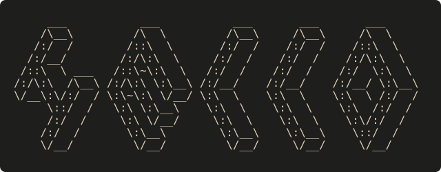

  

<h3 align="center">Elizandro Duran</h3>

  

  &nbsp;
  

## About

- Computer Science student focused on Embedded Security and Software Engineering
- Currently learning **Rust**

## Tech Stack

<b>Languages</b>

  

<b>Frameworks</b>

  

<b>Cloud and Tools</b>

  

